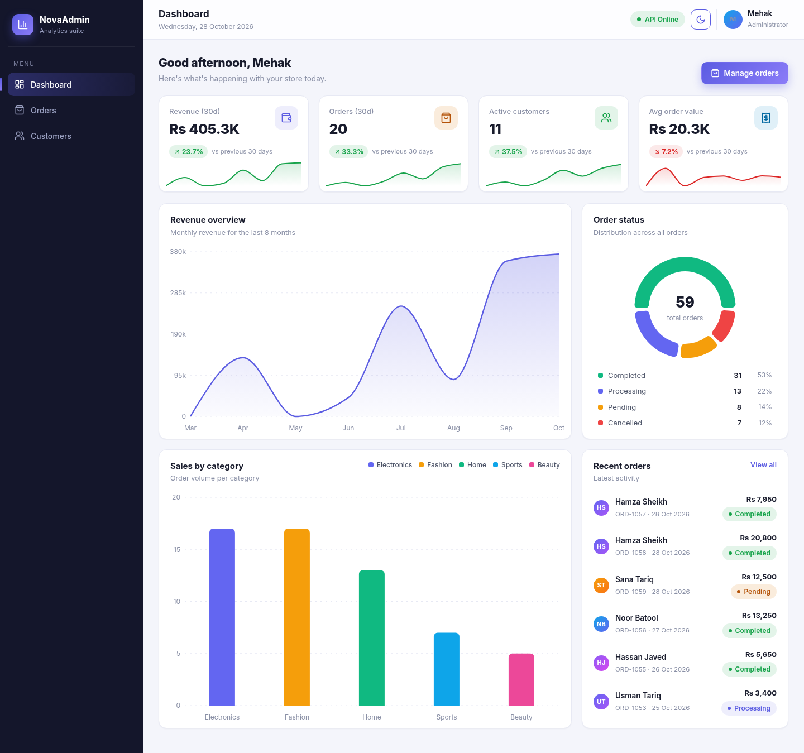
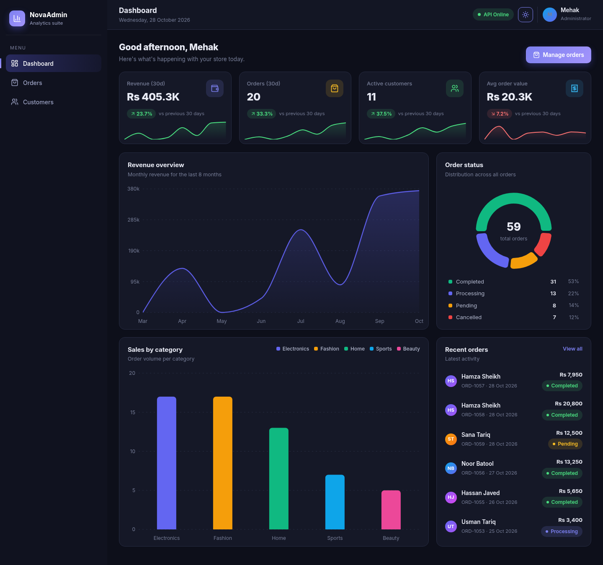
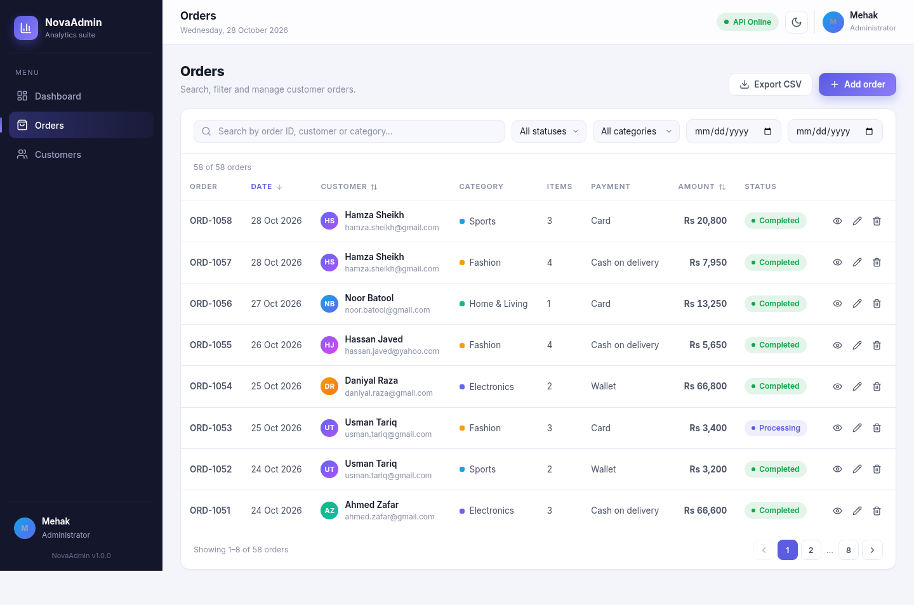
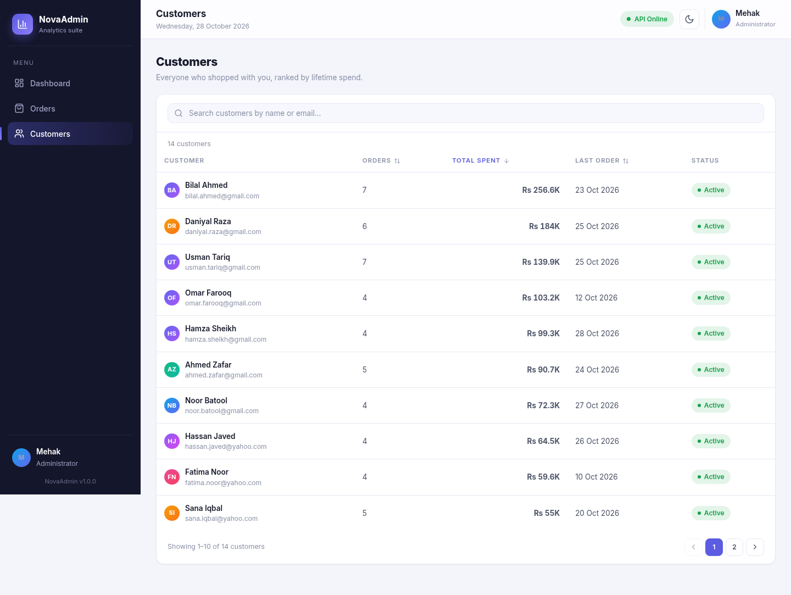
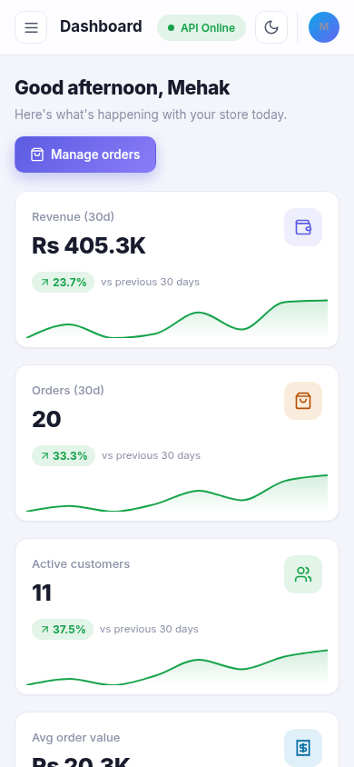

# NovaAdmin — Admin Analytics & Management Dashboard

**React JS Internship | Task 10**
Prepared by **Mehak**

A responsive admin dashboard built with React. It gives an at-a-glance view of store performance through KPI cards and charts, and lets the administrator search, filter, sort and fully manage order records — with proper loading, error and empty states handled throughout.

## Links

- **Live demo:** _paste your Vercel link here after deploying_
- **GitHub repository:** _paste your repo link here after pushing_

## Screenshots

| Light | Dark |
| --- | --- |
|  |  |

| Orders | Customers |
| --- | --- |
|  |  |

Mobile layout:



## Features

- **Dashboard layout** — fixed sidebar navigation, sticky header, content area and reusable layout components. Collapses into a slide-in drawer on mobile.
- **KPI cards** — revenue (30d), orders (30d), active customers and average order value, each with a month-over-month delta and a mini sparkline.
- **Charts (Recharts)** — revenue area chart, orders-by-category bar chart and an order-status donut, all with custom tooltips, legends and readable labels.
- **Records table** — orders listed with customer avatars, categories, amounts, payment method and status badges.
- **Search, filter & sort** — debounced search, status/category filters, date range filter, and clickable column sorting with proper `aria-sort` states.
- **Record management** — view details, create, edit and delete orders. Deleting asks for confirmation first. Form inputs are validated inline.
- **API integration** — a mock REST-style service layer with simulated network latency. Data persists to `localStorage`, so changes survive reloads.
- **Loading, error & empty states** — skeleton rows and cards while loading, a friendly error state with retry, and a clear empty state when filters match nothing.
- **CSV export** — the currently filtered and sorted orders can be exported with one click.
- **Dark / light theme** — toggle in the header, remembers your choice.
- **Responsive & accessible** — works on mobile and desktop; semantic HTML, labelled controls, visible focus states, keyboard-dismissable dialogs.

## Tech stack

- React 18 + Vite
- React Router (client-side routing)
- Recharts (data visualization)
- Lucide icons
- Hand-written CSS with design tokens (no UI framework, so the look stays custom)

## Getting started

You need Node.js 18+ installed.

```bash
npm install
npm run dev
```

Then open http://localhost:3000.

Other scripts:

```bash
npm run build     # production build into dist/
npm run preview   # serve the production build locally
```

## Environment variables

Copy `.env.example` to `.env` if you want to rename the app:

```bash
cp .env.example .env
```

Only `VITE_`-prefixed variables reach the browser, so these are safe to commit. Right now it just holds the app name shown in the sidebar.

## How the mock API works

The `src/api` folder pretends to be a backend. Every request goes through a fake network layer that adds 350–850ms of latency, and data is persisted in `localStorage` (key `novaadmin.orders.v1`). The seed data is generated with a seeded PRNG, so the demo numbers stay consistent between reloads.

Two handy things for the demo:

- The **API Online/Offline chip** in the header flips the mock API offline. Reload the page or try an action and you will see the error states with a working retry flow. Click it again to go back online.
- To reset all demo data, run `localStorage.clear()` in the browser console and refresh.

## Project structure

```
src/
├── api/               # mock REST layer (client, db, orders, customers)
├── components/
│   ├── charts/        # Recharts wrappers + shared tooltip
│   ├── kpi/           # KPI card
│   ├── layout/        # sidebar, header, layout shell
│   ├── orders/        # table, toolbar, form & details modals
│   ├── ui/            # buttons, badges, modals, toasts, states, pagination…
│   └── customers/
├── hooks/             # useOrders, useCustomers, useTheme, useDebouncedValue
├── pages/             # dashboard, orders, customers, 404
├── styles/            # design tokens + component styles
└── utils/             # formatting, stats calculations, csv export
```

## Deployment

The app deploys as a static SPA. For Vercel:

1. Push this repository to GitHub.
2. On Vercel, click *Add New → Project* and import the repo.
3. Vercel auto-detects Vite — just confirm the build command (`npm run build`) and deploy.

A `vercel.json` is included so client-side routes (like `/orders`) work on refresh. For Netlify, add a `_redirects` file with `/* /index.html 200` instead.

## Submission checklist

- [x] Intern name and task title (top of this file)
- [ ] GitHub repository link (add above after pushing)
- [ ] Deployed live demo link (add above after deploying)
- [x] Screenshots of the completed application (`screenshots/` folder)
- [x] Git commits with meaningful messages (`git log --oneline`)

Tested before submitting: charts, search/filter/sort, add/edit/delete flows, confirmation dialog, offline error state, CSV export, mobile layout and the deployed link.
